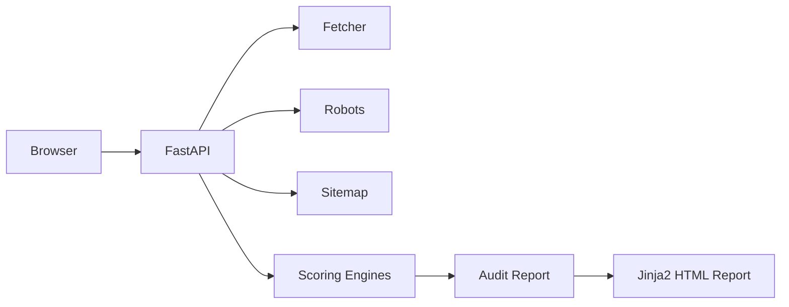

# GEO Auditor

GEO Auditor is a FastAPI application that audits a business website and estimates how visible it is to AI answer engines such as ChatGPT Search, Google AI Overviews, Gemini, Perplexity, Claude, and Bing Copilot. It produces an explainable 100-point score, evidence-backed findings, and copy-pasteable fixes — typically in ~1–3 seconds when running in deterministic mode.

Built as a take-home submission for the **Product Developer (AI Products)** role at **Phaze AI**.

---

## TL;DR

 - FastAPI GEO auditing tool
 - Explainable 100-point score with evidence-backed findings
 - Deterministic core (fast) + optional Gemini semantic layer (optional, may add latency)
 - HTML report + text-first PDF export
 - Runs locally with no database or authentication


## 1. Problem Statement

Search behavior is shifting from link-based search engines to generative answer engines. A business can rank #1 on Google and still be largely invisible in AI answers because AI systems select sources using retrieval-augmented generation (RAG) — extractability, entity confidence, and structured context — not PageRank.

This discipline goes by several names: **GEO** (Generative Engine Optimization), **AEO** (Answer Engine Optimization), or **LLMO**. Few SMBs or B2B SaaS teams have a simple way to check where they stand.

## 2. What GEO Auditor Does

Enter a URL and get back:

1. An **explainable 100-point score**, broken down across 10 categories
2. **Concrete evidence** — the exact scraped text, missing tags, or code found
3. A **priority roadmap**, sorted by impact vs. effort
4. **Copy-pasteable fixes** — JSON-LD, `robots.txt` rules, HTML snippets — generated from the site's own scraped content

Target users: **B2B SaaS startups and professional-service SMBs**.

## 3. Product Overview

- No login, no database, no persistence — enter a URL, get a report, done.
- The report is the product: every score is backed by a specific, evidence-backed finding.
- Typical runtime: ~1–3 seconds in deterministic mode (no live LLM calls). Enabling Gemini may increase latency depending on network and API availability.
- Run locally: `uvicorn app.main:app --reload` and open `http://127.0.0.1:8000`.

## 4. Architecture



`orchestrator.py` fetches the page HTML, `robots.txt`, and `sitemap.xml`
**concurrently** via `asyncio.gather`, parses the HTML once, then runs all
four scoring engines concurrently against the shared parsed page. `scoring.py`
aggregates the ten `AuditSection`s into one `AuditReport` — total score, letter
grade, AI Answerability Matrix, and a priority roadmap sorted by impact × effort.

### Why a Hybrid Architecture?

The GEO Auditor uses deterministic Python rules for technical accessibility,
schema validation, and structural extractability so scores remain fully
reproducible. Gemini 1.5 Flash is used only for constrained semantic
evaluation and personalized recommendation generation, with `temperature=0`
and strict JSON validation. If the API is unavailable, the audit still
completes successfully using deterministic fallbacks.

Concretely: **8 of the 10 categories are 100% deterministic Python** (crawler
accessibility, JS rendering risk, structured entity data, entity completeness,
quote readiness, fact density, media-to-text balance, freshness). Only **Query
Coverage** and **AI Citation Snippet Quality** touch the LLM layer — and even
those have a full heuristic fallback path, so nothing in the product ever
depends on Gemini being reachable.

## 5. Scoring Methodology

### The frozen 100-point model

The original spec's category table summed to **110**, not 100. It has been rebalanced to exactly 100 points, optimized to better reflect real-world GEO behavior on established sites. Structured Entity Data is rebalanced from 15 → 10, and Query Coverage is increased from 10 → 15. This reduces the over-penalization of missing structured data (which established brands often lack on-page but compensate for via off-page authority signals) and places greater emphasis on content answerability and coverage.

| Category                                | Points | Engine |
|------------------------------------------|:------:|--------|
| AI Crawler Accessibility                  | 15     | Technical (deterministic) |
| Structured Entity Data                    | 10     | Entity (deterministic) |
| Entity Completeness and Trust Signals     | 10     | Entity (deterministic) |
| Quote Readiness / Answer Extractability   | 15     | Content (deterministic) |
| Query Coverage                            | 15     | Intelligence (Gemini + fallback) |
| AI Citation Snippet Quality               | 10     | Intelligence (Gemini + fallback) |
| Fact Density and Structured Tables        | 10     | Content (deterministic) |
| Freshness Signals                         | 5      | Technical (deterministic) |
| JavaScript Rendering Risk                 | 5      | Technical (deterministic) |
| Media-to-Text Balance                     | 5      | Content (deterministic) |
| **Total**                                 | **100**| |

**Rationale for the rebalancing:** Structured Entity Data was trimmed to 10 points (7 pts for valid JSON-LD on-page, 3 pts for trusted `sameAs` links). Query Coverage was increased to 15 points (the four fundamental dimensions — what/who/problem/outcome — are worth 3.75 pts each). This rebalancing ensures that established brands like GitHub are not penalised too harshly for lacking perfect on-page schemas as long as their core page content answers fundamental queries. See `app/config.py` (`SCORE_WEIGHTS`) for the single source of truth.

### Grade scale

We use a calibrated 5-tier grade scale to describe search answerability:
- **85–100 (Grade A):** Excellent AI answerability
- **70–84 (Grade B):** Strong AI visibility
- **55–69 (Grade C):** Moderate / partial visibility
- **40–54 (Grade D):** Weak AI visibility
- **<40 (Grade F):** High risk of AI invisibility

A site like GitHub (~63 score) lands at **Grade C — Moderate / partial visibility**,
not "poor." This is intentional: we are measuring **on-page GEO readiness**, not
overall brand authority. Large brands that rank well in AI answers due to
off-page signals (Wikipedia, Knowledge Graph, backlinks, brand mentions) may
receive lower on-page scores — see the calibration note in every report.

### Deterministic vs. LLM-assisted

- **Deterministic (75 of 100 points):** robots.txt parsing, JSON-LD schema
  validation, DOM structure (headings, tables, lists, images), regex-based
  numeric density, word counts, and HTTP HEAD checks for trust pages. These
  never call an external API, are fully reproducible, and run in roughly
  1-2 seconds total.
- **LLM-assisted (25 of 100 points):** Query Coverage and Citation Snippet
  Quality ask Gemini 1.5 Flash to judge, using *only* the page's own text, and
  return strict JSON. If Gemini is unavailable, disabled, or errors, a
  keyword/heuristic fallback (audience-targeting phrases, outcome/metric
  language, problem-framing language) scores the same two categories instead,
  so the audit always produces a complete report.

## 5a. Design Philosophy

The UI intentionally follows a restrained SaaS dashboard aesthetic focused on
readability, evidence, and decision-making rather than decorative SEO-tool
styling. The design system is defined entirely via CSS custom properties
(`--bg`, `--surface`, `--primary`, `--text`, etc.) in `static/style.css`,
with Inter as the body font and a dark neutral palette (#0b1020 → #1f2937)
inspired by Linear, Vercel, and Notion dashboards. Heavy shadows are replaced
with 1px borders; accent colors are limited to a single indigo (`#6366f1`)
for primary actions. Max-width containers (~1200px) keep content focused, and
progressive disclosure (expandable evidence blocks, copy-paste buttons) keeps
the interface scannable.

## 5b. PDF Export

Starting with the latest version, **Download PDF** uses ReportLab Platypus to
generate a structured, text-first PDF report — replacing the previous
"Print HTML to PDF" approach which produced messy output with UI artifacts.

The PDF generator (`app/services/pdf_service.py`) produces an A4 portrait
document with:

- 1-inch margins
- Header ("GEO Auditor") and footer (page number + generation timestamp) on
  every page
- Clean sections: Executive Summary, Score Breakdown (table), Top Priorities,
  Detailed Findings, AI Answerability Matrix, Recommendations Recap
- Copy-paste fixes rendered as monospace code blocks with proper line wrapping
- Long URLs broken naturally at `/` and `.` characters

The PDF endpoint is at `GET /audit/pdf/{report_id}`. When you run an audit,
the report is stored in an in-memory cache keyed by a UUID `report_id`. The
"Download PDF" button on the report page links directly to this endpoint.

**Why ReportLab instead of HTML printing?** HTML printing (via `window.print()`) captures whatever the browser renders — including scrollbars, background colors, interactive UI elements, and CSS that behaves differently on paper. A text-first PDF ensures the report is clean, print-ready, and free of UI artifacts.

## 6. Gemini Integration — Important Caveat

The Gemini REST client (`app/services/llm_service.py`) is fully implemented:
`temperature=0`, strict JSON response mode, per-`(url, finding_type)` caching,
timeout handling, and error-message propagation back into the report as
`llm_error`.

**However: live Gemini API calls were not validated from inside the build
sandbox.** That environment's outbound network is restricted to a small
package-registry allowlist (PyPI, npm, GitHub, etc.) and does not include
`generativelanguage.googleapis.com`. The client code follows Gemini's
documented REST contract, but you should verify it against a real
`GEMINI_API_KEY` before relying on it in production — the app was built and
tested end-to-end in **deterministic fallback mode** (no key configured),
which is also its default, zero-config state.

To enable Gemini, set `GEMINI_API_KEY` in `.env` — no code changes needed.

## 7. Setup Instructions

### Requirements
- Python 3.11+

### Steps

```bash
python -m venv .venv
source .venv/bin/activate   # Windows: .venv\Scripts\activate
pip install -r requirements.txt
cp .env.example .env
uvicorn app.main:app --reload
```

Open **http://127.0.0.1:8000**.

### Environment variables (all optional — `.env.example`)

| Variable | Default | Purpose |
|---|---|---|
| `GEMINI_API_KEY` | *(unset)* | Enables the Gemini semantic layer. App works fully without it. |
| `GEMINI_MODEL` | `gemini-1.5-flash` | Gemini model name |
| `GEMINI_BASE_URL` | Google's public endpoint | Rarely needs changing |
| `REQUEST_TIMEOUT_SECONDS` | `8.0` | Timeout for fetching the target site/robots/sitemap |
| `LLM_TIMEOUT_SECONDS` | `6.0` | Timeout per Gemini call |
| `MAX_HTML_BYTES` | `3000000` | Safety cap on HTML processed per audit |
| `APP_ENV` | `development` | Informational only |

## 8. Example Report Section

From a real audit run against a live site during development (deterministic
mode, no Gemini key):

> **AI Crawler Accessibility — 8 / 15**
> ⚠️ *PerplexityBot is blocked in robots.txt*
> **Why it matters:** PerplexityBot cannot crawl this site at all, so content
> is structurally invisible to that AI answer engine regardless of content
> quality.
> **Evidence:** `robots.txt` disallows `/` for user-agent matching
> `PerplexityBot`.
> **Fix:** Remove the `Disallow: /` rule for PerplexityBot or scope it
> narrowly.
> ```
> User-agent: PerplexityBot
> Allow: /
> ```

Full sample reports are in [`sample_reports/`](sample_reports/) and served at `/report/sample/report_1`, `/report_2`, `/report_3`. One sample was generated against a live, network-reachable site during development to validate the end-to-end pipeline.

## 9. Scope Cuts and Rationale

To keep this a focused, runnable take-home rather than a sprawling platform,
the following were deliberately **cut**:
- **No database, no auth, no history.** Audits are stateless and ephemeral — suitable for a take-home and avoids database overhead.
- **No headless-browser rendering.** JS Rendering Risk is measured from raw HTML rather than spinning up Playwright/Puppeteer — faster and more representative for the targeted failure mode.
- **TTFB is approximated as total fetch time.** `httpx` doesn't expose time-to-first-byte separately without lower-level socket instrumentation; adding that felt out of scope for this diagnostic metric.
- **Single-page audits only.** The v1 focus is homepage + `robots.txt` + `sitemap.xml`. A multi-page crawl is a clear v2 but would exceed the per-audit time budget.
- **LLM layer is intentionally minimal (2 of 10 categories).** This was a deliberate product decision: the LLM sharpens two heuristic categories without making API reachability a hard dependency. It also keeps the core audit free to run at scale without API costs for 80% of the score.

## 10. Future Improvements

- **Multi-page crawl** (homepage + top N pages by internal link count) for a
  more representative Query Coverage and Fact Density score.
- **Historical tracking** — store audits (would require the database this v1
  deliberately skips) to show score trends after fixes are shipped.
- **Real TTFB instrumentation** via `httpx` event hooks.
- **Headless rendering fallback** specifically to distinguish "this SPA is
  invisible to AI crawlers" from "this SPA would be fine if crawlers ran JS,"
  which the current static-HTML-only check can't fully separate.
- **Competitive benchmarking** — audit 2-3 competitor URLs alongside the
  target and show relative GEO positioning.
- **Validate the Gemini integration against a real API key** and tune prompt
  wording using real disagreement cases between the LLM judgments and the
  deterministic fallback heuristics.

## 11. Why This Demonstrates Product Judgment

- **Caught and fixed a spec bug rather than silently absorbing it.** The
  original scoring table summed to 110; rather than quietly picking numbers
  that summed to 100, the discrepancy was flagged, a rebalancing was
  proposed with explicit rationale, and it was implemented as a single
  source of truth with a startup-time assertion so it can never drift again.
- **Optional-dependency design.** A take-home spec that requires a paid,
  rate-limited third-party API to even *demo* the product is a fragile demo.
  Structuring 80% of the score as fully deterministic — with the LLM layer
  as a value-add, not a dependency — is the same trade-off a real GEO Auditor
  vendor would have to make to keep unit economics sane at scale.
- **Every finding is falsifiable.** Each `Finding` carries its own evidence
  string pulled from the actual scraped page — not a generic template — which
  is the entire point of a *credible* audit tool aimed at technical and
  non-technical buyers alike.
- **Honest about what wasn't validated.** The Gemini REST integration is
  fully built but explicitly flagged as unvalidated against a live key,
  rather than presented as tested when it wasn't. A take-home that overstates
  its own test coverage is a worse signal than one that's precise about it.

---

## Project Structure

```text
geo-auditor/
├── app/
│   ├── main.py                 # FastAPI app + routes + REPORT_CACHE + request logging
│   ├── config.py               # Settings + frozen SCORE_WEIGHTS (single source of truth)
│   ├── models.py               # Pydantic v2 models (includes report_id field)
│   ├── orchestrator.py         # Concurrent fetch + engine execution (generates uuid)
│   ├── scoring.py              # Aggregation, grading, answerability matrix
│   ├── engines/
│   │   ├── technical_engine.py      # Crawler access, JS risk, freshness
│   │   ├── entity_engine.py          # JSON-LD schema, trust pages
│   │   ├── content_engine.py          # Quote readiness, fact density, media balance
│   │   └── intelligence_engine.py      # Query coverage, citation quality (Gemini + fallback)
│   ├── services/
│   │   ├── fetcher.py                   # Async HTTP fetch w/ browser headers
│   │   ├── robots.py                     # Custom robots.txt parser (AI-bot aware)
│   │   ├── sitemap.py                     # Sitemap discovery + lastmod extraction
│   │   ├── html_utils.py                   # Shared BeautifulSoup helpers
│   │   ├── llm_service.py                   # Gemini REST client w/ cache + fallback
│   │   └── pdf_service.py                   # ReportLab Platypus text-first PDF generator
│   ├── templates/
│   │   ├── index.html                        # Landing page (hero, CTA, how-it-works)
│   │   └── report.html                       # Full audit report (modern SaaS dashboard UI)
│   └── static/
│       ├── style.css                        # CSS design system w/ variables
│       └── app.js                           # Copy buttons, form loading state
├── sample_reports/                              # 3 pre-generated sample reports
├── requirements.txt
├── README.md
├── .env.example
└── .gitignore
```

## Run Checklist

## How to Evaluate This Submission

1. Start the app: `uvicorn app.main:app --reload`
2. Open `http://127.0.0.1:8000` and run an audit for a SaaS site (e.g. `https://www.hubspot.com`).
3. Inspect the HTML report and click **Download PDF** to validate the PDF export.
4. Verify the health endpoint: `http://127.0.0.1:8000/health`.
5. Optional: view sample reports at `/report/sample/report_1`, `/report_2`, `/report_3`.


```bash
python -m venv .venv
source .venv/bin/activate   # Windows: .venv\Scripts\activate
pip install -r requirements.txt
cp .env.example .env
uvicorn app.main:app --reload
```

App available at: **http://127.0.0.1:8000**
Health check: **http://127.0.0.1:8000/health**
