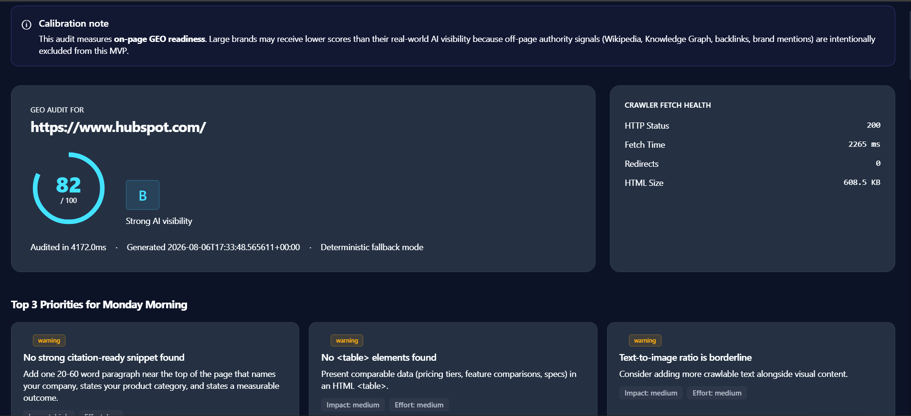
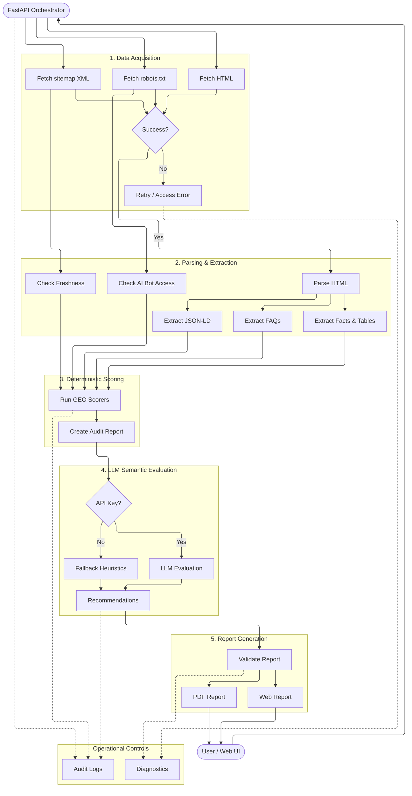

# GEO Auditor

GEO Auditor is a FastAPI application that audits a business website and estimates how visible it is to AI answer engines such as ChatGPT Search, Google AI Overviews, Perplexity, Claude, and Bing Copilot. It produces an explainable 100-point score, evidence-backed findings, and copy-pasteable fixes — typically in ~1–3 seconds.



## 1. Problem Statement

Search behavior is shifting from link-based search engines to generative answer engines. A business can rank #1 on Google and still be largely invisible in AI answers because AI systems select sources using retrieval-augmented generation (RAG) — extractability, entity confidence, and structured context — not PageRank.

This discipline goes by several names: **GEO** (Generative Engine Optimization), **AEO** (Answer Engine Optimization), or **LLMO**. Few SMBs or B2B SaaS teams have a simple way to check where they stand.

## 2. What GEO Auditor Does

Enter a URL and get back:

1. An **explainable 100-point score**, broken down across 10 categories
2. **Concrete evidence** — the exact scraped text, missing tags, or code found
3. A **priority roadmap**, sorted by impact vs. effort
4. **Copy-pasteable fixes** — JSON-LD, `robots.txt` rules, HTML snippets — generated from the site's own scraped content

Target users: **B2B SaaS startups and professional-service SMBs**.

## 3. Product Overview

- No login, no database, no persistence — enter a URL, get a report, done.
- A short-lived in-memory cache (`REPORT_CACHE`, TTL 1 hour) stores reports so
  the PDF download endpoint can serve the previously generated report without
  re-running the audit. On server restart the cache is empty.
- The report is the product: every score is backed by a specific, evidence-backed finding.
- Typical runtime: ~1–3 seconds in deterministic mode. Enabling the optional LLM layer may add latency.
- Run locally: `uvicorn app.main:app --reload` and open `http://127.0.0.1:8000`.
- A hybrid scoring system: **80% deterministic Python** (crawler access, schema
  validation, DOM structure, fact density) + an **optional LLM layer** for two
  semantic categories (Query Coverage, Citation Snippet Quality), with
  heuristic fallbacks so the audit always completes.

## 4. Architecture

The system follows a five-stage pipeline: data acquisition → parsing & extraction → deterministic scoring → optional LLM semantic evaluation → report generation.



`orchestrator.py` fetches the page HTML and `robots.txt` **concurrently** via `asyncio.gather`, then fetches `sitemap.xml` using sitemap hints discovered in `robots.txt`. It parses the HTML once, then runs all scoring engines concurrently (via `asyncio.to_thread` for the CPU-bound deterministic engines and native `async`/`await` for the LLM-backed ones) against the shared parsed page. `scoring.py` aggregates the ten `AuditSection`s into one `AuditReport` — total score, letter grade, AI Answerability Matrix, and a priority roadmap sorted by impact × effort.

### Why a Hybrid Architecture?

The GEO Auditor uses deterministic Python rules for technical accessibility, schema validation, and structural extractability so scores remain fully reproducible. The LLM layer is used only for two constrained semantic categories (Query Coverage and Citation Snippet Quality), with `temperature=0` and strict JSON output. If the API key is unset, the LLM is unavailable, or an error occurs, heuristic fallbacks score the same categories instead so the audit always completes successfully.

Concretely: **8 of the 10 categories are 100% deterministic Python** (crawler accessibility, JS risk, freshness, structured entity data, entity completeness, quote readiness, fact density, media-to-text balance). Only **Query Coverage** and **AI Citation Snippet Quality** touch the LLM layer — and even those have a full heuristic fallback path, so nothing in the product ever depends on the LLM provider being reachable.

## 5. Scoring Methodology

### The frozen 100-point model

The original spec's category table summed to **110**, not 100. It has been rebalanced to exactly 100 points. Structured Entity Data was trimmed from 15 → 10, and Query Coverage was increased from 10 → 15. This reduces the over-penalization of missing structured data (which established brands often lack on-page but compensate for via off-page authority signals) and places greater emphasis on content answerability and coverage.

| Category                                | Points | Engine |
|------------------------------------------|:------:|--------|
| AI Crawler Accessibility                  | 15     | Technical (deterministic) |
| Structured Entity Data                    | 10     | Entity (deterministic) |
| Entity Completeness and Trust Signals     | 10     | Entity (deterministic) |
| Quote Readiness / Answer Extractability   | 15     | Content (deterministic) |
| Query Coverage                            | 15     | Intelligence (LLM + fallback) |
| AI Citation Snippet Quality               | 10     | Intelligence (LLM + fallback) |
| Fact Density and Structured Tables        | 10     | Content (deterministic) |
| Freshness Signals                         | 5      | Technical (deterministic) |
| JavaScript Rendering Risk                 | 5      | Technical (deterministic) |
| Media-to-Text Balance                     | 5      | Content (deterministic) |
| **Total**                                 | **100**| |

See `app/config.py` (`SCORE_WEIGHTS`) for the single source of truth — a startup-time assertion ensures the total always equals 100.

### Grade scale

A calibrated 5-tier grade scale describes SEO answerability:
- **85–100 (Grade A):** Excellent AI answerability
- **70–84 (Grade B):** Strong AI visibility
- **55–69 (Grade C):** Moderate / partial visibility
- **40–54 (Grade D):** Weak AI visibility
- **<40 (Grade F):** High risk of AI invisibility

A site like GitHub (~63 score) lands at **Grade C — Moderate / partial visibility**, not "poor." This is intentional: the audit measures **on-page GEO readiness**, not overall brand authority. Large brands that rank well in AI answers due to off-page signals may receive lower on-page scores — see the calibration note in every report.

### Deterministic vs. LLM-assisted

- **Deterministic (75 of 100 points):** robots.txt parsing, JSON-LD schema validation, DOM structure (headings, tables, lists, images), numeric density, word counts, and HTTP HEAD checks for trust pages. These never call an external API, are fully reproducible, and run in ~1 second.
- **LLM-assisted (25 of 100 points):** Query Coverage and Citation Snippet Quality use the LLM to judge, using *only* the page's own text, and return strict JSON. If the LLM is unavailable, disabled, or errors, a keyword/heuristic fallback scores the same two categories instead, so the audit always produces a complete report.

## 6. Setup

### Requirements
- Python 3.11+

### Steps

```bash
python -m venv .venv
source .venv/bin/activate   # Windows: .venv\Scripts\activate
pip install -r requirements.txt
cp .env.example .env
uvicorn app.main:app --reload
```

Open **http://127.0.0.1:8000**.

### Environment variables (all optional — `.env.example`)

| Variable | Default | Purpose |
|----------|---------|---------|
| `GROQ_API_KEY` | *(unset)* | Enables the LLM semantic layer. App works fully without it. |
| `GROQ_MODEL` | `llama-3.1-8b-instant` | LLM model name |
| `GROQ_BASE_URL` | `https://api.groq.com/openai/v1` | Rarely needs changing |
| `REQUEST_TIMEOUT_SECONDS` | `8.0` | Timeout for fetching the target site/robots/sitemap |
| `LLM_TIMEOUT_SECONDS` | `6.0` | Timeout per LLM call |
| `MAX_HTML_BYTES` | `3000000` | Safety cap on HTML processed per audit |
| `APP_ENV` | `development` | Informational only |
| `FRONTEND_BASE_URL` | `https://geoauditor.pages.dev` | Frontend origin for server redirects (`GET /`, `POST /audit`, `/report/share`, `/api/render-shared`) |
| `CORS_ORIGINS` | *(empty)* | Comma-separated extra allowed origins (e.g. a custom domain) |

## 7. Deployments

### Local Development
```bash
python -m venv .venv
source .venv/bin/activate
pip install -r requirements.txt
cp .env.example .env
uvicorn app.main:app --reload
```

Open **http://127.0.0.1:8000**.

### Render (Production)

1. Push your code to `main` branch.
2. Create a new **Python** web service on [render.com](https://render.com).
3. Connect your GitHub repo.
4. Set these environment variables (or set them in Render dashboard):
   - `GROQ_API_KEY` (secret)
   - `GROQ_MODEL` (optional)
   - `GROQ_BASE_URL` (optional)
   - `REQUEST_TIMEOUT_SECONDS`
   - `LLM_TIMEOUT_SECONDS`
   - `MAX_HTML_BYTES`
   - `APP_ENV=production`
5. Deploy — the service will auto-deploy on every push to `main`.

**Health check:** `https://your-app.onrender.com/health`

**API base:** `https://your-app.onrender.com`

### Cloudflare Pages (Static Frontend) — see `frontend/`

The frontend in `frontend/` is a **static site** (no Python, no build step). It calls
the Render API (`/api/audit`) over the network; reports are rendered client-side from
the JSON response. This is why you get the free `*.pages.dev` domain **and** Cloudflare's
CDN/caching, while the Python backend stays on Render.

1. Create a new **Cloudflare Pages** project at [pages.cloudflare.com](https://pages.cloudflare.com).
2. Connect your GitHub repo.
3. Set **Build command** to: `echo "Static site — no build"`.
4. Set **Output directory** to: `frontend`.
5. **Name the project `geoauditor`** so it is served at `https://geoauditor.pages.dev` (no
   hyphen). This matches the default `FRONTEND_BASE_URL` and `ALLOWED_ORIGINS` baked into the
   backend — if you use a different name you must set `FRONTEND_BASE_URL` and `CORS_ORIGINS`
   on Render accordingly.
6. No environment variables are needed — the API base URL lives in the `api-base` meta tag
   in each HTML file (`frontend/index.html`, `frontend/report.html`, …). Point it at your
   Render URL, e.g. `https://geo-auditor-api.onrender.com`.
7. Deploy — your site is served from `https://geoauditor.pages.dev`.

**local preview:** `npx wrangler pages dev frontend`

**CORS:** the Render backend already allows `https://geoauditor.pages.dev`
(`ALLOWED_ORIGINS` in `app/main.py`). If your Pages domain differs, update that list
and redeploy Render.

**API base:** `https://your-app.onrender.com` (or your custom domain)

**Cloudflare Web Analytics:** Replace `YOUR_CWA_TOKEN_HERE` in `frontend/index.html`
and `frontend/report.html` with your token from the Cloudflare dashboard.

**Note on samples:** the "Sample reports" cards open the server-rendered samples hosted on
Render (`/report/sample/{id}`) in a new tab, since those are full HTML pages.

## 8. Example Report

From a real audit run against a live site during development (deterministic mode):

> **AI Crawler Accessibility — 8 / 15**
> ⚠️ *PerplexityBot is blocked in robots.txt*
> **Why it matters:** PerplexityBot cannot crawl this site at all, so content is structurally invisible to that AI answer engine regardless of content quality.
> **Evidence:** `robots.txt` disallows `/` for user-agent matching `PerplexityBot`.
> **Fix:** Remove the `Disallow: /` rule for PerplexityBot or scope it narrowly.

Full sample reports are in [`sample_reports/`](sample_reports/) and served at `/report/sample/github`, `/report/sample/hubspot`, `/report/sample/harvey`.

## 9. Scope Cuts

- **No database, no auth, no history.** Audits are stateless and ephemeral.
- **No headless-browser rendering.** JS Rendering Risk is measured from raw HTML rather than spinning up Playwright/Puppeteer.
- **TTFB is approximated as total fetch time** — `httpx` doesn't expose time-to-first-byte separately.
- **Single-page audits only.** The v1 focus is homepage + `robots.txt` + `sitemap.xml`.
- **LLM layer is intentionally minimal (2 of 10 categories).** This was a deliberate product decision: the LLM sharpens two heuristic categories without making API reachability a hard dependency.

## 10. Future Improvements

- **Multi-page crawl** (homepage + top N pages by internal link count).
- **Historical tracking** — store audits to show score trends after fixes are shipped.
- **Headless rendering fallback** to distinguish SPA rendering blind spots.
- **Competitive benchmarking** — audit competitors alongside the target.
- **Validate the LLM integration** against a real API key and tune prompt wording.

## Conclusion

Building GEO Auditor helped me explore how AI search systems discover, retrieve, and cite web content. One takeaway from this research: GEO does not replace SEO. Based on testing across Google Search, Perplexity, and AI Overviews, traditional SEO signals still appear to influence visibility, while GEO improves how effectively content can be understood and cited by AI systems. In practice, strong visibility likely requires both.

---

## Project Structure

```text
geo-auditor/
├── app/
│   ├── main.py                 # FastAPI app + routes + REPORT_CACHE + request logging
│   ├── config.py               # Settings + frozen SCORE_WEIGHTS (single source of truth)
│   ├── models.py               # Pydantic v2 models
│   ├── orchestrator.py         # Concurrent fetch + engine execution
│   ├── scoring.py              # Aggregation, grading, answerability matrix
│   ├── engines/
│   │   ├── technical_engine.py      # Crawler access, JS risk, freshness
│   │   ├── entity_engine.py          # JSON-LD schema, trust pages
│   │   ├── content_engine.py          # Quote readiness, fact density, media balance
│   │   └── intelligence_engine.py      # Query coverage, citation quality (LLM + fallback)
│   ├── services/
│   │   ├── fetcher.py                   # Async HTTP fetch w/ browser headers
│   │   ├── robots.py                     # Custom robots.txt parser (AI-bot aware)
│   │   ├── sitemap.py                     # Sitemap discovery + lastmod extraction
│   │   ├── html_utils.py                   # Shared BeautifulSoup helpers
│   │   ├── llm_service.py                   # LLM client w/ cache + fallback
│   │   ├── pdf_service.py                   # ReportLab text-first PDF generator
│   │   └── html_export.py                   # Standalone, self-contained HTML report (for /audit/html)
├── frontend/                              # Static Cloudflare Pages frontend (no build step)
│   ├── index.html                          # Landing page (static)
│   ├── report.html                         # Report shell — JS renders the audit from JSON
│   ├── 404.html / 429.html / 500.html     # Static error pages
│   ├── _headers                           # Cloudflare Pages security + cache headers
│   └── static/
│       ├── app.js                         # API calls + client-side report rendering
│       └── style.css / favicon / robots.txt / sitemap.xml
├── sample_reports/                              # 3 pre-generated sample reports (served at /report/sample/{id})
├── requirements.txt
├── README.md
├── Technical_Design_Document.md  # Deep-dive on architecture, design decisions, scoring rationale
├── .env.example
├── .gitignore
├── render.yaml                    # Render.com deployment config
```

## How to Evaluate This Submission

```bash
python -m venv .venv
source .venv/bin/activate   # Windows: .venv\Scripts\activate
pip install -r requirements.txt
cp .env.example .env
uvicorn app.main:app --reload
```

App available at: **http://127.0.0.1:8000**
Health check: **http://127.0.0.1:8000/health**

**Public Deployments:**
https://geoauditor.pages.dev


